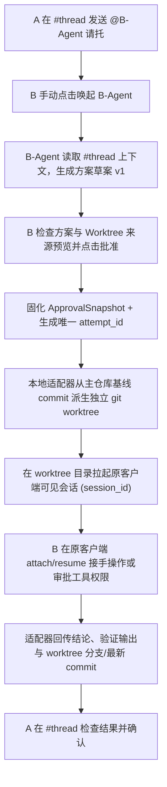

# 架构方案：最小概念、Worktree 溯源与原客户端适配边界

## 摘要

本文说明 MVP 的最小数据职责、状态流转、隔离 `git worktree` 的派生溯源规则以及客户端适配器契约。平台只负责保存团队身份、`#thread` 上下文、不可变批准快照与执行回执；具体的 `git worktree` 创建与原生会话拉起由所有者本地适配器及原有 coding 客户端完成，不建设重型分布式调度引擎。以下是架构提案，尚未实现生产代码。

范围见 [mvp.md](mvp.md)；关键设计取舍见 [ADR-001](adr/0001-thread-collaboration-and-native-handoff.md)。

## 目录

- [整体链路](#整体链路)
- [最小数据关系与状态](#最小数据关系与状态)
- [Worktree 派生与来源透明规则](#worktree-派生与来源透明规则)
- [最小适配器接口与防重契约](#最小适配器接口与防重契约)
- [并发、变更与取消规则](#并发变更与取消规则)
- [Dev Note](#dev-note)

## 整体链路



若是普通问答，`B 手动点击唤起 B-Agent` 后直接读取 `#thread` 消息并输出带引用编号的回复，不进入 `ApprovalSnapshot`、`git worktree` 和 `Attempt` 链路。

## 最小数据关系与状态

```text
Person ──拥有── PersonalAgent（稳定身份，不绑定特定模型或 session）
                    └── Endpoint（默认客户端类型、本地仓库根目录、唤醒策略=manual）
Thread（#thread） ──参与者 Person（其 PersonalAgent 自动继承可读范围）
  ├── Message（作者 Person/Agent、正文、版本号、@提及、引用消息 ID 列表）
  └── Work（一项需要执行的工作对应唯一一张状态卡）
        ├── ProposalRevision（做什么、完成条件、引用消息 ID+版本快照、目标仓库）
        ├── ApprovalSnapshot（批准人 B、批准时间、固化的主仓库/基线分支/基线 commit/预期 worktree 规则）
        └── Attempt（attempt_id / 幂等键）
              ├── WorktreeProvenance（主仓库路径、基线分支、基线 commit、worktree 路径、工作分支名、最新 head commit）
              ├── NativeBinding（客户端类型、原生 session_id、接手入口/命令）
              └── Receipt & Result（接收/执行/停止回执、结果摘要、验证输出、人工验收状态）
```

这些是逻辑数据职责，MVP 使用 SQLite 的少量表（`persons`、`agents`、`threads`、`messages`、`works`、`attempts`）加 JSON 字段即可，不建设独立消息总线或微服务。

### 核心状态流转

| 对象 | 最少状态集合 | 状态约束 |
|---|---|---|
| 消息 (`Message`) | `已保存` / `发送失败` | 只有收到适配器读取回执才可标记“Agent 已读取上下文” |
| 方案确认 (`Approval`) | `草案` / `待所有者确认` / `需补充` / `已拒绝` / `已批准` / `已失效` | 仅当引用的关键消息被修改且改变了任务目标/范围，或主仓库基线冲突无法派生时才置为 `已失效` |
| 执行尝试 (`Attempt`) | `待投递` / `已接收` / `排队中` / `执行中` / `待本人介入` / `已结束` / `失败` / `已停止` / `状态未知` | 传输成功不等于 `已接收`；断线且未完成本地核对前必须显示 `状态未知` |
| 停止请求 (`Cancel`) | `无` / `已请求停止` / `已确认停止` / `停止未确认` | 收到本地进程及子进程退出证据后才置为 `已确认停止` |
| 人工验收 (`Review`) | `待人工检查` / `已确认` / `需继续` | 由人在 `#thread` 的明确操作或回复触发，绝不由 `Attempt=已结束` 自动变为 `已确认` |

## Worktree 派生与来源透明规则

按 **Separate Before Serializing Shared State** 原则，代码修改不在所有者的主工作区直接覆写，而是由本地适配器为每次获批的执行尝试（`Attempt`）派生独立的 `git worktree`，并在 UI 全程透明展示其来龙去脉。

### 1. 每个 Worktree 必须记录并展示的五项来源信息 (`WorktreeProvenance`)

1. **主仓库路径 (`source_repo_path`)**：例如 `~/code/order-service`（告诉所有者是从本地哪个仓库分出来的）。
2. **派生基线 (`base_branch` + `base_commit`)**：例如 `main @ a1b2c3d`（告诉团队这次修改是基于哪个分支、哪次提交起步的）。
3. **隔离目录路径 (`worktree_path`)**：例如 `~/code/.melody-wt/order-service-work-42-1`（告诉所有者原客户端当前在哪个具体文件夹里读写）。
4. **工作分支名 (`work_branch`)**：例如 `melody/work-42-attempt-1`（方便后续在本地直接 `git diff main...melody/work-42-attempt-1`、合并或提 PR）。
5. **当前变更状态 (`head_commit` + `dirty_summary`)**：回传结果时记录该 worktree 的最新 commit 及改动文件数。

### 2. 生命周期与冲突边界

- **确认前预览：** 确认单生成时，本地适配器读取目标主仓库当前指定分支的 `HEAD commit`，在确认单上预填上述五项来源信息供 B 检查。
- **确认后派生：** B 点击批准后，适配器执行 `git -C <source_repo_path> worktree add -b <work_branch> <worktree_path> <base_commit>`，并在该 `<worktree_path>` 下写入 `.melody-attempt.json`（含 `work_id`、`attempt_id`、`approval_revision`）。
- **接手与复用：** 原客户端会话的工作目录（`cwd`）直接绑定到 `<worktree_path>`；同一 `Attempt` 期间 B 在原工具补充输入均在该 worktree 内继续。
- **不自动合并与不静默删代码：** 执行结束后保留该 worktree 与工作分支供 B 检查、测试或提 PR；适配器可执行 `git merge-tree` 做无副作用的合并冲突预检并在结果卡提示，但平台不自动 merge 回主分支，也不在未经 B 确认前删除含未合并提交的 worktree。

## 最小适配器接口与防重契约

按 **Boundary Discipline** 与 **Make Operations Idempotent** 原则，平台与所有者本地客户端适配器之间只保留 6 个最小操作：

1. `inspect_capabilities()`：返回客户端类型（如 `claude-code`、`codex`）、是否支持只读唤起、原生会话拉起方式及主仓库基线信息。
2. `invoke_proposal(thread_id, message_ids, mode="manual_readonly")`：由所有者手动点击触发，读取指定 `#thread` 消息上下文，生成回答或方案草案。
3. `dispatch_attempt(work_id, approval_snapshot, attempt_id)`：幂等投递获批工作。适配器先核对本地是否已存在 `attempt_id` 对应的 `.melody-attempt.json` 或原生 session，不存在才创建 worktree 并拉起原生可见会话。
4. `reconcile_attempt(attempt_id)`：断线恢复或超时核对。查询本地持久记录、worktree 状态与原生会话进程，返回真实状态（未启动 / 运行中 / 已结束 / 未知）。
5. `request_cancel(attempt_id)`：终止对应原生会话进程组，返回是否已确认停止。
6. `report_event(attempt_id, event_seq, payload)`：回传状态变更、需要本人介入提示或最终结果（含 `WorktreeProvenance` 与测试输出）。

### 断线防重复开工（R3 已确认机制）

- 每次批准生成的 `attempt_id` 全局唯一。
- 适配器在拉起原客户端进程**之前**，必须先把 `attempt_id -> {worktree_path, native_session_id, status}` 原子写入本地状态文件（以及 worktree 内的 `.melody-attempt.json`）。
- 若在回执传回平台前断线，重连后平台先调 `reconcile_attempt(attempt_id)` 或带同一 `attempt_id` 重试 `dispatch_attempt`；适配器命中本地记录后直接返回已有会话与 worktree 绑定，**绝不创建第二个 worktree 或拉起第二个会话**。
- 若本地状态文件损坏且无法核对，状态置为 `状态未知`，由所有者 B 在界面选择“关联已有目录”或“创建新尝试 #2”，平台不自动重跑。

## 并发、变更与取消规则

- **同仓库并发隔离：** 两项工作同时指向同一主仓库时，因各自派生独立的 `worktree_path` 与 `work_branch`，可安全并行而不污染彼此的工作区；仅在同一 `Attempt` 的同一原生会话内串行排队。
- **批准后群聊变更隔离：** `ApprovalSnapshot` 保存了批准时刻的引用消息内容哈希与版本。批准后 `#thread` 中的新消息不会自动注入正在运行的会话；若需求范围变更，B 需基于新消息确认新方案版本。
- **迟到事件防护：** 所有回执与结果事件均携带 `attempt_id` 与递增 `event_seq`；旧 `Attempt` 的迟到输出归档在历史记录中，不能覆盖新 `Attempt` 或已确认停止的状态卡。

## Dev Note

本节非权威。MVP 阶段本地适配器与平台服务可在同一台开发机或局域网内通过简单 HTTP/WebSocket 或本地进程调用通信，无需引入消息队列中间件。
