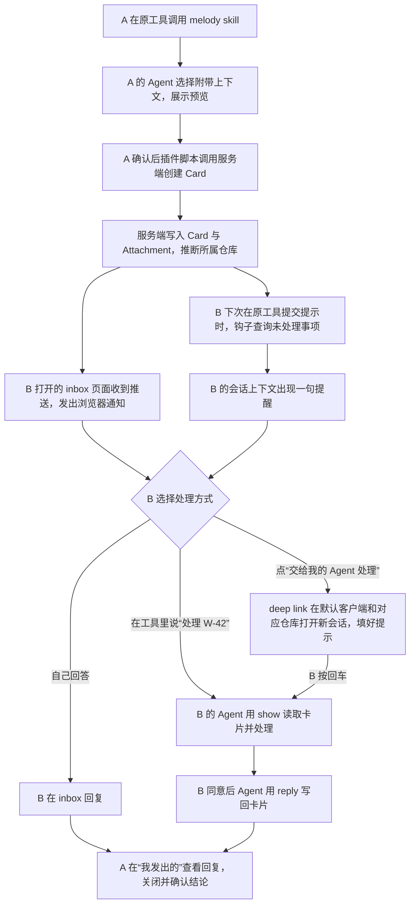
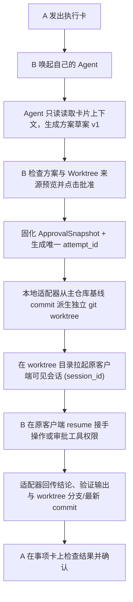

# 架构方案：事项卡、提醒与交接链路、原客户端适配边界

## 摘要

本文说明 melody 的最小数据职责、状态流转、交付阶段 1 的创建、提醒与交接链路，企业微信通道的接入点，以及交付阶段 3 的隔离 `git worktree` 派生溯源规则和客户端适配器契约。melody 的核心是事项卡服务（服务端与 inbox 页面）；coding 客户端插件、浏览器通知和企业微信都是挂在核心周围的入口或通知通道。平台只保存人的身份与接入配置、事项卡及其往来记录、不可变批准快照与执行回执；Agent 的运行始终发生在接收人自己的 coding 客户端中。以下是架构提案，尚未实现生产代码。

范围见 [mvp.md](mvp.md)；关键设计取舍见 [ADR-001](adr/0001-thread-collaboration-and-native-handoff.md)、[ADR-002](adr/0002-inbox-cards-instead-of-chat.md) 与 [ADR-003](adr/0003-cards-addressed-to-people.md)。

## 目录

- [最小数据关系与状态](#最小数据关系与状态)
- [核心与外围通道](#核心与外围通道)
- [交付阶段 1：创建、提醒与交接链路](#交付阶段-1创建提醒与交接链路)
- [交付阶段 2：企业微信通道](#交付阶段-2企业微信通道)
- [交付阶段 3：执行交接链路](#交付阶段-3执行交接链路)
- [Worktree 派生与来源透明规则](#worktree-派生与来源透明规则)
- [最小适配器接口与防重契约](#最小适配器接口与防重契约)
- [并发、变更与取消规则](#并发变更与取消规则)
- [Dev Note](#dev-note)

## 最小数据关系与状态

```text
Person（人的稳定身份）
  └── Endpoint（接入配置：默认客户端、可选客户端、本地代码根目录）
Card（事项卡：编号、类型=问题|执行、请求、状态、
      可见范围=参与者|团队、所属仓库、结论条目）
  ├── Participant（人、角色=发起人|接收人|读者；接收人恰好一人；交付阶段 1 无读者）
  ├── Attachment（发起人确认附带的上下文片段：来源、内容、内容哈希、依据的仓库与 commit）
  ├── Entry（往来记录，按时间追加，关闭后仍可追加：作者、作者方式=本人|经本人同意的 Agent、类型=回复|追问|补充|状态变化、正文、时间）
  ├── ReadMark（每个参与者最后读取的位置，供未读与浏览器通知去重）
  └── Work（仅执行卡，交付阶段 3）
        ├── ProposalRevision（做什么、完成条件、引用的附带内容与往来记录快照、目标仓库）
        ├── ApprovalSnapshot（批准人、批准时间、固化的主仓库/基线分支/基线 commit/预期 worktree 规则）
        └── Attempt（attempt_id / 幂等键）
              ├── WorktreeProvenance（主仓库路径、基线分支、基线 commit、worktree 路径、工作分支名、最新 head commit）
              ├── NativeBinding（客户端类型、原生 session_id、接手入口/命令）
              └── Receipt & Result（接收/执行/停止回执、结果摘要、验证输出、人工验收状态）
```

这些是逻辑数据职责，使用 SQLite 的少量表（`persons`、`endpoints`、`cards`、`card_participants`、`card_attachments`、`card_entries`、`read_marks`，交付阶段 3 增加 `works`、`attempts`）加 JSON 字段即可，不建设独立消息总线或微服务。inbox 是按参与角色过滤的视图，不是另一种事项。交付阶段 1 的「待我处理」是角色为接收人且未关闭的卡，「我发出的」是角色为发起人的卡。以后的「分享给我的」是角色为读者的卡。同一张卡不因为分享而复制。

`Card` 的可见范围、所属仓库、附带内容中的依据 commit 和结论条目在交付阶段 1 只做记录，供交付阶段 3 之后的知识沉淀使用：可见范围决定卡片能否进入团队检索，依据 commit 用于判断回答是否过时，所属仓库用于按项目检索，结论条目避免事后再由模型总结往来记录。所属仓库从附带内容的文件路径推断，结论条目在发起人关闭问题卡时由其确认的回答确定，均不要求发起人填写。

### 核心状态流转

| 对象 | 最少状态集合 | 状态约束 |
|---|---|---|
| 事项卡 (`Card`，交付阶段 1) | `待处理` / `已读` / `已回复` / `已关闭` | 只有发起人能关闭；钩子提醒、浏览器通知与企业微信推送只读取状态，不改变状态 |
| 方案确认 (`Approval`，交付阶段 3) | `草案` / `待接收人确认` / `需补充` / `已拒绝` / `已批准` / `已失效` | 仅当引用的附带内容或往来记录被修改且改变了任务目标/范围，或主仓库基线冲突无法派生时才置为 `已失效` |
| 执行尝试 (`Attempt`，交付阶段 3) | `待投递` / `已接收` / `排队中` / `执行中` / `待本人介入` / `已结束` / `失败` / `已停止` / `状态未知` | 传输成功不等于 `已接收`；断线且未完成本地核对前必须显示 `状态未知` |
| 停止请求 (`Cancel`，交付阶段 3) | `无` / `已请求停止` / `已确认停止` / `停止未确认` | 收到本地进程及子进程退出证据后才置为 `已确认停止` |
| 人工验收 (`Review`，交付阶段 3) | `待人工检查` / `已确认` / `需继续` | 由发起人在事项卡上的明确操作触发，绝不由 `Attempt=已结束` 自动变为 `已确认` |

## 核心与外围通道

| 通道 | 入口：创建事项卡 | 通知：告知接收人 | 操作：处理事项卡 |
|---|---|---|---|
| coding 客户端插件 | skill 一句话发起，Agent 打包上下文 | 钩子在接收人使用工具时提醒其 Agent | Agent 读取卡片、处理、经本人同意写回回复 |
| inbox 页面 | 交付阶段 1 不提供 | 页面打开时的浏览器通知、未读标记 | 本人回复、追问、关闭；deep link 交给自己的 Agent |
| 企业微信（交付阶段 2） | @应用或机器人一句话发起 | 推送按钮卡片并更新同一张卡 | “收到”“验收”等低风险操作 |

所有通道只通过服务端 API 读写事项卡。外部通道中的操作只能改变服务端状态，不能直接让接收人电脑上的工具开始工作；接收人电脑上的 Agent 只在本人发出提示后运行。

## 交付阶段 1：创建、提醒与交接链路



交付阶段 1 由三个部件组成，不需要常驻客户端：

- **melody 服务端：** HTTP API、SQLite 存储、inbox 页面，以及向已打开的 inbox 页面推送新事件的长连接（如 SSE）。
- **melody 插件：** 分别打包给 Claude Code 与 Codex，包含 skill（`ask`、`show`、`reply`）、`SessionStart` 与 `UserPromptSubmit` 钩子配置，以及 skill 与钩子调用的命令行脚本。skill 说明何时发起、如何挑选附带上下文、发送前必须展示预览、写回前必须征得本人同意。
- **个人令牌与接入配置：** 插件脚本用本地保存的个人令牌访问服务端；接入配置记录默认客户端和本地代码根目录，供 inbox 生成 deep link。

### 钩子契约

钩子调用的脚本必须满足以下约束，钩子失败不能影响接收人正常使用原工具：

- 只输出未处理事项的数量、编号、标题和发起人，用事实性陈述书写，不输出卡片正文或附带上下文；读取全文由 Agent 显式调用 `show`。
- 设置短超时；服务端不可达、令牌缺失或超时时输出空内容并以成功码退出，不阻塞提示提交。
- 没有未处理事项时输出空内容。
- 不调用模型、不修改仓库、不改变事项卡状态。

### deep link 交接契约

inbox 详情页的“交给我的 Agent 处理”按接收人的接入配置生成 deep link：

- 链接中的提示只包含固定句式和卡片编号（“处理 melody 事项卡 W-42”），不包含请求正文或附带上下文；Agent 通过 `show` 经个人令牌读取全文。
- 工作目录由卡片的所属仓库与接收人的本地代码根目录确定；找不到对应本地仓库时不传目录，由接收人在工具中自行切换。
- 链接只填写提示、不发送；接收人按回车才开始处理，因此 deep link 本身不构成唤起。
- 客户端不支持指定目录（如 Cursor）时，提示中附带仓库名，由 Agent 提醒接收人确认当前工作区。

## 交付阶段 2：企业微信通道

企业微信作为外围通道接入同一套服务端 API：

- **入口：** 接收应用或机器人收到的一句话消息，创建事项卡。消息本身之外的群聊上下文不可读，这类卡片只携带这句话和发起人显式提供的内容。
- **通知与操作：** 通过自建应用或智能机器人向接收人推送按钮卡片，记录卡片与 `response_code` 的对应关系；收到按钮回调后在 5 秒内应答并更新事项卡状态，再用 `update_template_card` 更新同一张企业微信卡片。`response_code` 失效后，重发卡片或在卡片上引导回 inbox。
- **边界：** 企业微信中的操作只改变服务端状态；执行确认不在企业微信卡片上完成。若要从企业微信直接让接收人电脑上的 Agent 开始工作，需要接收人本机运行常驻进程监听服务端，不在交付阶段 2 范围内。

## 交付阶段 3：执行交接链路



问题卡由接收人自己回答或交给自己的 Agent 回答，写入往来记录，不进入 `ApprovalSnapshot`、`git worktree` 和 `Attempt` 链路。

## Worktree 派生与来源透明规则

按 **Separate Before Serializing Shared State** 原则，代码修改不在接收人的主工作区直接覆写，而是由本地适配器为每次获批的执行尝试（`Attempt`）派生独立的 `git worktree`，并在确认单与事项卡上全程展示其来源。

### 1. 每个 Worktree 必须记录并展示的五项来源信息 (`WorktreeProvenance`)

1. **主仓库路径 (`source_repo_path`)**：例如 `~/code/order-service`（告诉接收人是从本地哪个仓库分出来的）。
2. **派生基线 (`base_branch` + `base_commit`)**：例如 `main @ a1b2c3d`（告诉团队这次修改是基于哪个分支、哪次提交起步的）。
3. **隔离目录路径 (`worktree_path`)**：例如 `~/code/.melody-wt/order-service-work-42-1`（告诉接收人原客户端当前在哪个具体文件夹里读写）。
4. **工作分支名 (`work_branch`)**：例如 `melody/work-42-attempt-1`（方便后续在本地直接 `git diff main...melody/work-42-attempt-1`、合并或提 PR）。
5. **当前变更状态 (`head_commit` + `dirty_summary`)**：回传结果时记录该 worktree 的最新 commit 及改动文件数。

### 2. 生命周期与冲突边界

- **确认前预览：** 确认单生成时，本地适配器读取目标主仓库当前指定分支的 `HEAD commit`，在确认单上预填上述五项来源信息供接收人检查。
- **确认后派生：** 接收人点击批准后，适配器执行 `git -C <source_repo_path> worktree add -b <work_branch> <worktree_path> <base_commit>`，并在该 `<worktree_path>` 下写入 `.melody-attempt.json`（含 `card_id`、`attempt_id`、`approval_revision`）。
- **接手与复用：** 原客户端会话的工作目录（`cwd`）直接绑定到 `<worktree_path>`；同一 `Attempt` 期间接收人在原工具补充输入均在该 worktree 内继续。
- **不自动合并与不静默删代码：** 执行结束后保留该 worktree 与工作分支供接收人检查、测试或提 PR；适配器可执行 `git merge-tree` 做无副作用的合并冲突预检并在事项卡上提示，但平台不自动 merge 回主分支，也不在接收人确认前删除含未合并提交的 worktree。

## 最小适配器接口与防重契约

按 **Boundary Discipline** 与 **Make Operations Idempotent** 原则，平台与接收人本地客户端适配器之间只保留 6 个最小操作：

1. `inspect_capabilities()`：返回客户端类型（如 `claude-code`、`codex`）、是否支持只读唤起、原生会话拉起方式及主仓库基线信息。
2. `invoke_proposal(card_id, mode="manual_readonly")`：由接收人手动触发，读取指定事项卡的请求、附带上下文与往来记录，生成回答或方案草案。
3. `dispatch_attempt(card_id, approval_snapshot, attempt_id)`：幂等投递获批工作。适配器先核对本地是否已存在 `attempt_id` 对应的 `.melody-attempt.json` 或原生 session，不存在才创建 worktree 并拉起原生可见会话。
4. `reconcile_attempt(attempt_id)`：断线恢复或超时核对。查询本地持久记录、worktree 状态与原生会话进程，返回真实状态（未启动 / 运行中 / 已结束 / 未知）。
5. `request_cancel(attempt_id)`：终止对应原生会话进程组，返回是否已确认停止。
6. `report_event(attempt_id, event_seq, payload)`：回传状态变更、需要本人介入提示或最终结果（含 `WorktreeProvenance` 与测试输出）。

### 断线防重复开工

- 每次批准生成的 `attempt_id` 全局唯一。
- 适配器在拉起原客户端进程**之前**，必须先把 `attempt_id -> {worktree_path, native_session_id, status}` 原子写入本地状态文件（以及 worktree 内的 `.melody-attempt.json`）。
- 若在回执传回平台前断线，重连后平台先调 `reconcile_attempt(attempt_id)` 或带同一 `attempt_id` 重试 `dispatch_attempt`；适配器命中本地记录后直接返回已有会话与 worktree 绑定，**绝不创建第二个 worktree 或拉起第二个会话**。
- 若本地状态文件损坏且无法核对，状态置为 `状态未知`，由接收人在界面选择“关联已有目录”或“创建新尝试 #2”，平台不自动重跑。

## 并发、变更与取消规则

- **同仓库并发隔离：** 两项工作同时指向同一主仓库时，因各自派生独立的 `worktree_path` 与 `work_branch`，可安全并行而不污染彼此的工作区；仅在同一 `Attempt` 的同一原生会话内串行排队。
- **批准后变更隔离：** `ApprovalSnapshot` 保存了批准时刻引用内容的哈希与版本。批准后事项卡上的新补充不会自动注入正在运行的会话；若需求范围变更，接收人需基于新补充确认新方案版本。
- **迟到事件防护：** 所有回执与结果事件均携带 `attempt_id` 与递增 `event_seq`；旧 `Attempt` 的迟到输出归档在历史记录中，不能覆盖新 `Attempt` 或已确认停止的状态。

## Dev Note

本节非权威。服务端可在同一台开发机或局域网内通过简单 HTTP 与 SSE 提供，无需引入消息队列中间件。交付阶段 3 的本地适配器是否需要常驻，取决于方案确认是否只在接收人本机发起：若确认后同样通过 deep link 在本机工具中启动执行，适配器可以作为插件脚本按需运行；若要从 inbox 或企业微信远程投递，则需要常驻进程。
