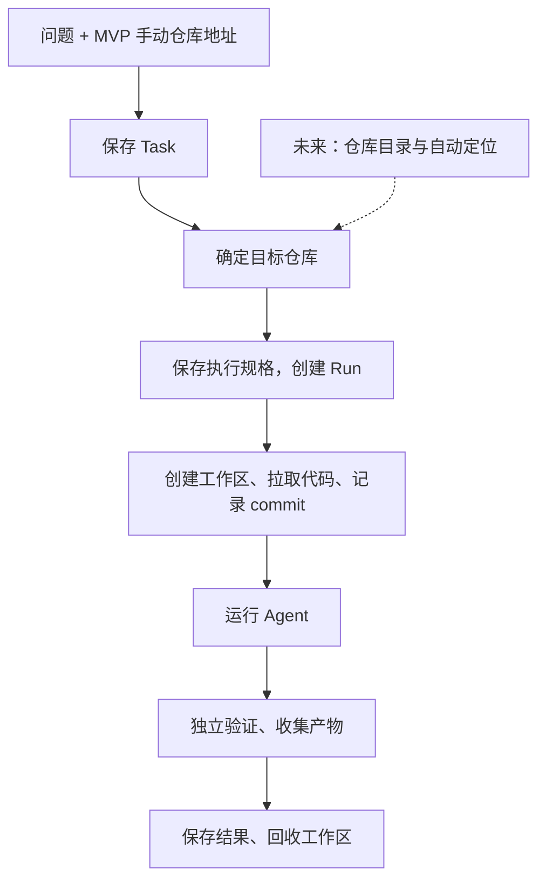

# MVP 的实现骨架与后续扩展位置

## 摘要

本文帮助实现人员用少量模块边界衔接当前 MVP 和长期目标。手动仓库选择与未来自动定位都产生执行规格，任务生命周期和结果归应用管理。以下是实现提案，不是已实现能力说明。

状态：设计建议，尚无产品代码验证。范围见 [mvp.md](mvp.md)；决策理由见 [ADR-001](adr/0001-separate-resolution-and-execution.md)。

## 目录

- [主链路](#主链路)
- [现在保留的四个边界](#现在保留的四个边界)
- [当前最少需要的数据](#当前最少需要的数据)
- [用扩展场景检查边界](#用扩展场景检查边界)
- [Dev Note](#dev-note)

## 主链路

下面展示提案的数据流；各步骤在一个应用内组织，自动定位尚不纳入本轮实现。

图中的方框是同一应用内的职责划分，不代表多个服务。首版只需单体管理服务加一个后台 Worker；函数和模块即可，不建设插件框架、通用调度器或消息总线。

## 现在保留的四个边界

这些边界约束职责和数据归属，不要求本轮提供多套可替换实现。

### 1. 问题与仓库选择分开

Task 保存用户问题及可选的仓库提示。V0 在请求校验中要求提供一个仓库；确定目标仓库的函数直接采用人工输入，记录 `source=manual`。后续由仓库目录和自动定位实现同一职责，产生 `source=automatic` 及定位依据。

执行端只接收确定后的仓库清单，不自己从用户原文猜仓库。V0 清单必须恰好一项；多项或缺失明确拒绝，不悄悄只执行第一项。未来增加多仓库执行时再放开校验并补跨仓库语义。

V0 不实现自动定位、置信度算法或澄清状态机。未来定位失败时可保留 Task 并请求澄清，无需预先启动沙箱。

### 2. 用户任务与一次执行分开

- `Task`：稳定的问题工作项，保存原始问题和输入。
- `Run`：一次执行尝试，属于一个 Task，保存此次输入快照、阶段、结果和时间。
- `ExecutionSpec`：Run 的执行规格，包含问题快照、仓库清单、依赖/验证配置，以及所用运行配置引用。V0 可直接存为 Run 的 JSON 字段，无需独立服务或表。

Task ID、Run ID、Agent 原生 Session ID 和容器 ID 分别记录。Session 和容器属于运行资源，不能充当用户任务 ID。以后重试创建新 Run，保留旧结果；V0 不需要先做重试 UI。

仓库项记录 URL、请求的分支、实际检出的 commit 和工作目录。准备完成后固定此次基线，不能因默认分支移动而改写历史。访问凭证通过执行时的配置引用获取，不放入 Task、URL 或日志；V0 只用一套预配置凭证，不开发凭证平台。

### 3. 任务流程与执行技术分开

Worker 负责按顺序调用准备、Agent 执行、独立验证、收集、清理。Docker 操作放在工作区模块，OpenHands 调用和事件转换放在 Agent 模块；业务 API 和页面不直接依赖 SDK 会话对象。

V0 各只有一个具体实现，不要求抽象基类、动态加载或 Provider 注册中心。以后替换 Agent 或沙箱时优先改对应模块，Task/Run 和结果结构继续使用。新增组合仍需真实验证，不能因模块已分开就宣称兼容。

### 4. 执行结果独立于 Agent 自述和容器寿命

Run 保存阶段和终态；Agent 事件转换为本系统的简单日志记录（run_id、序号、时间、类型、内容），可另存脱敏后的供应商原始事件用于排查。页面消费自己的日志，不直接绑定某家 SDK 的全部字段。

Result 至少包含执行结束原因、验证状态、命令/退出码/输出和产物位置。验证状态区分通过、失败、未运行；只有 Worker 独立验证通过才能显示“验证通过”，仍不等于已经证明所有产品行为正确。

产物按 Run 保存，补丁额外记录仓库和基线 commit。V0 保存到服务器文件目录，SQLite 保存索引；以后换对象存储不改变结果含义。先导出再清理，导出失败需明确显示，不能回报完整交付。失败和取消也尽力保留已有产物。

状态由 Worker 和管理服务确定；LLM 不能直接写成功状态。取消、超时或中断形成终态后，迟到的完成事件不能将其覆盖。用持久状态条件更新即可，V0 不做完整事件溯源。

## 当前最少需要的数据

两张业务表 Task、Run，加每次 Run 的日志和产物目录即可。ExecutionSpec/Result 可为 JSON 字段。Run 中保留工作区标识，用于停止与重启后的容器核对；重启策略先采用明确中断和清理，不承诺自动续跑。

仓库目录、自动定位索引、多 Agent 工作流和分布式调度均不预建空表或服务。接口与数据关系能够表达后续变化，即完成本轮预留。

## 用扩展场景检查边界

后续实现以下场景时，检查是否能够沿用既有任务、执行和结果结构。

- 人工输入改成系统定位：新增定位实现和仓库目录，既有执行流程继续接收仓库清单。
- 重试同一问题：同一 Task 下增加 Run，旧日志与补丁仍可追溯。
- 换执行技术：改 Agent 或工作区模块，页面继续展示统一状态和产物；原生会话恢复按新实现能力另验收。
- 支持多仓库：已有列表和按仓库归属的产物可复用；仍需新增依赖顺序、联合验证和部分失败规则，这些没有被“预留字段”自动解决。

实现验收时走查以上数据流即可；不为尚未实现的能力编写虚构的通过测试。

## Dev Note

无。
